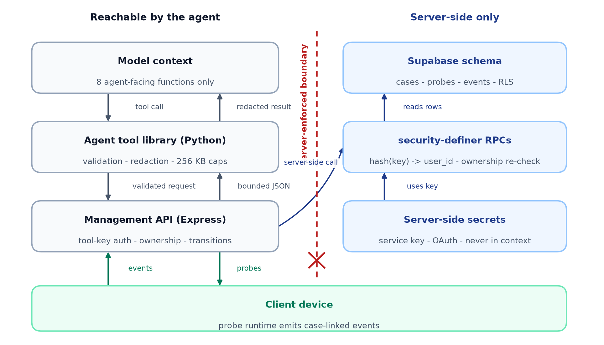
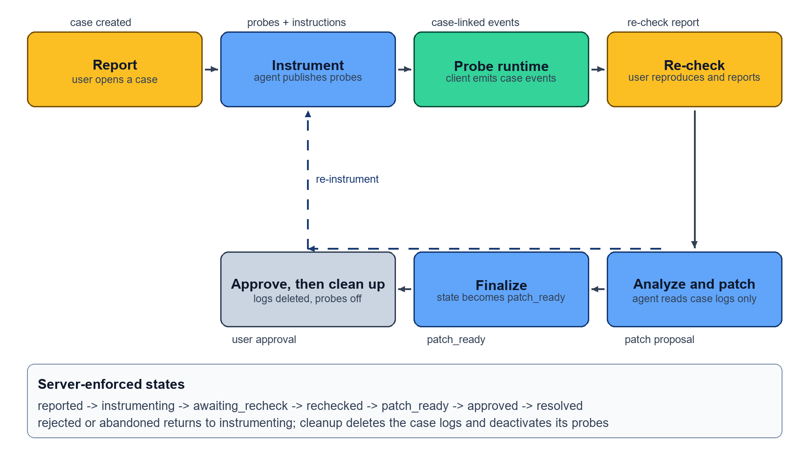
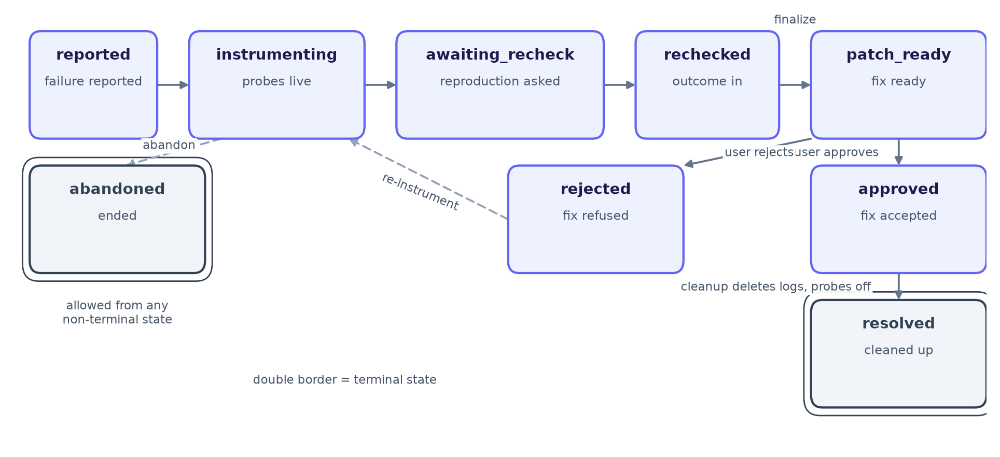
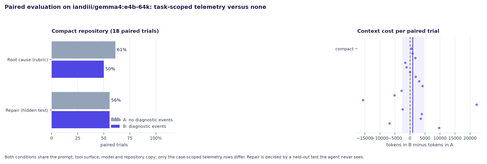

# Remote Client Telemetry for Repository-Level Coding Agents: A Closed-Loop Debugging Protocol

*Consent-scoped device telemetry, withdrawable instrumentation, and server-enforced separation of evidence from repair validation for small local coding agents*

## Abstract

Repository-level coding agents read source code and run local tests, but they cannot observe failures on a user's remote device. We present **Remote Telemetry Tool**, a prototype architecture that gives a coding agent task-scoped client telemetry and closes the loop between diagnosis, repair and device-side verification. It combines bounded, redacted retrieval; a server-enforced case state machine the agent cannot skip or approve for the user; and probes published as data and withdrawn at cleanup, so a client emits nothing until asked. We report paired evaluations where the same local Gemma 4 model, prompts, tools and repository copies ran with and without diagnostic telemetry on synthetic client failures, repair decided by a hidden test. Across 36 paired trials in two repository variants telemetry did not improve repair (exact McNemar p = 1.000 in each): it helped where the cause was ambiguous and cost turns where the cause was already visible in the code. The artifact implements the protocol end to end; 102 tests pass, and no deployment-security or production-reliability claim is made.

## 1. Introduction

Coding agents work inside a repository sandbox with file inspection, code edits and local tests, but not the runtime behavior of a user's phone or another remote client. A report such as "the highlight palette does not open" is under-specified: the failure could arise from a missing state transition, a presentation-context issue, an authorization response, or a device-specific condition.

Remote telemetry could narrow that search, but broad database access is unsafe and can flood a limited context window with noisy or sensitive events. The question is therefore:

> **Can a constrained, task-scoped telemetry tool give repository-level coding agents actionable remote-client evidence without widening data exposure, and when does that evidence change debugging outcomes?**

Our contribution is a protocol, its client and server halves, and a controlled measurement of what the evidence is worth.

1. **A closed debugging loop.** A server-enforced state machine separates *evidence collected* from *repair validated*: the agent cannot skip the user or approve a fix for them.
2. **Reversible, runtime-selectable instrumentation.** Probes are published as data, so an agent can refine what it observes without shipping a new build, and are withdrawn when the case closes.
3. **An explicit verification boundary.** A paired pilot, an invalid earlier run kept for audit, and an adversarial suite replace a claim.

## 2. Related Work

*Repository-level agents.* SWE-bench [1] evaluates whether models resolve real GitHub issues from a description and a repository snapshot; SWE-agent [2] shows that the agent-computer interface, not only the model, materially changes performance; Agentless [3] shows that a simple localization-repair-validation pipeline can beat complex scaffolds. Mobile agent work gets closer: AppAgent [11] operates smartphone apps through a tap-and-swipe action space, Mobile-Agent-v2 [10] adds planning and reflection over screen history, and AndroidWorld [12] validates success by inspecting device system state. Those systems read the device through pixels or a benchmark harness; none lets an agent *select runtime instrumentation* on a user's device.

*Closed-loop repair and runtime evidence.* Autonomic computing [7] contributes the canonical monitor-analyze-plan-execute loop, RepairAgent [8] drives an LLM repair agent with a finite state machine interleaving evidence gathering, repair and validation, and RCAgent [9] diagnoses a deployed cloud system from runtime evidence. On instrumentation, TaintDroid [13] records information-flow facts on a real device, Sage [14] localizes root causes from distributed traces, and fault-injection tooling [20] injects failures into running systems. Our claim is narrower: not a new event format or control loop, but the *protocol* that joins them for an agent debugging one user's device under a human approval gate, with instrumentation published as data, scoped to one case and withdrawn at its end.

*Untrusted tool output and small local models.* Retrieved or tool-returned content can hijack an agent's instructions [15], and AgentDojo [16] is the standard benchmark for that risk; our tool output is therefore evidence, never instructions, and the harness asserts this. AgentBench [17] reports that open models trail much larger ones, which is why we use a small local Gemma 4 build [4]. SWE-Gym [18] shows that execution feedback can train agents, the natural direction for case-scoped telemetry as a training signal.

The gap is narrow and testable: **no reviewed system treats the end user's device as an explicit participant in an agentic debugging loop with agent-selected, withdrawable instrumentation, a server-enforced separation between evidence collection and repair validation, a human approval gate before telemetry deletion, and a paired measurement of the evidence's value.**

## 3. System Design and Method

### 3.1 Client event capture

An instrumented client emits a compact event when a relevant operation fails: a bounded event name, a bounded error category, app and build version, OS version, and a correlation identifier, for example `{"level": "error", "event": "palette_presentation_failed", "detail": {...}}`. It excludes raw user content, access tokens and unrestricted device data. By default the client collects nothing; capture is attached to an active probe for a specific case.

### 3.2 Storage and access control

The Supabase schema defines app-owned tables for users, sessions, client logs, debug cases, probes, case reports and tool keys. A `client_logs` row carries a bounded `level` and `event` name, a JSONB `detail` object, a server-generated timestamp, and a nullable `case_id` linking the event to the debugging attempt that requested it.

The schema is not by itself a security boundary. Every access goes through security-definer RPCs that hash the presented key, resolve it to an owning `user_id`, and verify that the requested case belongs to that user before returning or mutating anything; the functions pin `search_path = ''` and revoke execute privileges from `public`, `anon` and `authenticated` before targeted grants [5, 6]. The backend holds a server-only Supabase secret key that bypasses RLS, so the rules live in application code and RPC bodies; a deployment must add defense in depth and never expose that key to a client or to model context.

### 3.3 Agent tool boundary

The agent never receives arbitrary SQL or unrestricted credentials. `telemetry_tool.py` exposes one agent-facing function per capability; each validates its arguments locally, calls the management API with a developer key, and returns JSON to the model (Table 1).

| Tool | Bounds enforced before the call |
| --- | --- |
| `list_debug_cases_for_agent(limit, state)` | `limit` 1..100; known `state` |
| `fetch_case_logs_for_agent(case_id, limit)` | UUID `case_id`; `limit` 1..100 |
| `fetch_recent_client_logs_for_agent(limit, client_session_id)` | `limit` 1..100; optional session filter |
| `request_instrumentation_for_agent(case_id, instructions, probes)` | ≤20 probes; `probe_id` ≤80; `target` ≤200; `level` in {info, warn, error} |
| `await_user_recheck_for_agent(case_id, instructions, probes)` | same bounds; probes optional |
| `finalize_case_for_agent(case_id)` | only from `rechecked` |
| `abandon_case_for_agent(case_id)` | only from non-terminal states |
| `cleanup_case_for_agent(case_id)` | only from `approved`; deletes telemetry, deactivates probes |

Output is bounded as well as input. Detail objects are redacted recursively against a fixed set of sensitive keys; free-text fields are scrubbed for e-mail addresses and long digit runs and truncated at 4000 characters; response size is capped at 256 KB. These are defense-in-depth measures, not a privacy guarantee.

Tool output is untrusted diagnostic data: log strings can contain secrets or prompt-injection text, so the agent must treat retrieved events as evidence, never instructions. Every call is authenticated by key and scoped to one account, and ownership is re-checked server-side (Figure 1).

### 3.4 The closed debugging loop

Read access alone does not close the loop: the agent cannot request better evidence, cannot know whether the reproduction succeeded, and cannot verify that a patch fixed the symptom. The protocol is therefore bidirectional, stateful and human-in-the-loop.

The client first reports the failure, creating a `debug_cases` row with the user's own description and capturing no telemetry. The agent publishes probes (`probe_id`, `target`, bounded `capture` object, `level`) and instructions; the client applies them at runtime and links every resulting event to the case. When the agent asks the user to try again, the case moves to `awaiting_recheck` and the client polls case state with a version counter, so no push infrastructure is required; the client's answer is appended to `case_reports` and moves the case to `rechecked`. The agent then reads only case-scoped evidence, separates observation from inference, inspects the repository and proposes a minimal patch, and calls `finalize_case` to reach `patch_ready`; it cannot skip that state or approve for the user. Only after the user approves may the agent call `cleanup_case`, which deletes the case's telemetry, deactivates its probes so the device stops collecting, and marks the case `resolved`.

Figure 3 draws the state machine enforced in the Express layer and the RPCs: `reported` → `instrumenting` → `awaiting_recheck` → `rechecked` → `patch_ready` → `approved` → `resolved`, with `abandoned` reachable from any non-terminal state and `rejected` returning to `instrumenting`. A disallowed transition yields an error, not an inconsistent record.

### 3.5 The client probe runtime

The device half is a library, not a script. `ai_client_demo/probe_runtime.py` polls the case endpoint, receives the active probe set, applies probes to instrumentation points in the app, and emits bounded events linked to that case. Four behaviors are tested: *silence by default* (no probe set, no event), *selection at runtime* (probes arrive as data), *allow-listed capture* (only fields named in a probe's `capture` object are recorded, with size capped) and *withdrawal* (at a terminal case state the probes are dropped and collection stops; when the probe set cannot be confirmed the runtime fails closed and emits nothing).

## 4. Implementation

*Tool library and database.* `telemetry_tool.py` validates arguments (UUIDs, limits, probe shapes), posts to the management API and returns JSON strings; it never receives a Supabase key, and session keys stay hidden from model-visible output. `supabase_setup.sql` and `migration_debug_cases.sql` define the schema, RPCs, grants and case tables.

*Backend, dashboard, agent and client.* `web_demo/server/server.js` is an Express server with Google OAuth, app-owned users and opaque sessions, separate developer and ingest keys (hashed at rest and individually revocable), and the case lifecycle over HTTP: `/api/client/cases/*` for the client and `/api/tool/cases/*` for the agent. `ollama_agent.py` exposes the protocol as OpenAI-compatible function tools for an Ollama-hosted agent with workspace read, patch and test tools; `ai_client_demo/probe_runtime.py` is the client probe runtime and `ai_client_demo/debug_loop_demo.py` drives the full loop against a running backend.

*Evaluation.* `eval/` contains the paired harness: a synthetic six-task application in two sizes (compact, and larger with ten plausible distractor modules), a fixture backend serving owner-scoped synthetic cases and telemetry rows, an agent loop with a read-only telemetry surface, and the statistics. No production data, live case identifiers or network endpoint other than the local model are involved.

## 5. Experiments and Evaluation

### 5.1 Verification performed

Seven suites run deterministically: dashboard logic (7), server (21), tool (12), agent runner (14), harness (18), adversarial (21) and probe runtime (9). The first four are unit tests over mocked clients; the last three cover the harness, the adversarial suite and the client runtime. None is a security audit, a proof of correctness under concurrency, or evidence that a deployed system behaves as the mocks do.

### 5.2 An exploratory run that we do not report as evidence

An earlier three-task run with `gemma4:31b:cloud` is retained in `eval/results/eval_summary.json` for auditability but marked invalid: the first runner counted any tool call as a resolution, so it cannot establish repair or a paired comparison. We kept it because deleting an inconvenient result is itself a methodological failure.

### 5.3 Paired evaluation: task-scoped telemetry against none

We ran the same 6 synthetic tasks with 3 repeats each on two repository variants, giving 18 paired trials per variant (36 in total) against the local fixture backend with `iandiii/gemma4:e4b-64k` (seed 20261028). The compact variant is the application itself; the larger adds ten plausible but wrong modules to reject. Condition A's case-scoped telemetry was empty; condition B's contained the diagnostic events. Within a pair, prompt, tool schemas, repository copy and model were identical, trial order was randomized, repair was decided by the held-out validation test the agent never saw, and root cause was scored by a frozen rubric that cannot observe the condition.

| Outcome (18 pairs per variant) | Compact A | Compact B | Larger A | Larger B |
| --- | --- | --- | --- | --- |
| Validation test passed | 10/18 | 10/18 | 6/18 | 5/18 |
| Root cause matched rubric | 11/18 | 9/18 | 13/18 | 10/18 |
| Named the responsible module | 14/18 | 13/18 | 14/18 | 11/18 |
| Telemetry fetches / file edits | 10 / 20 | 7 / 21 | 5 / 29 | 9 / 22 |

Telemetry did not improve repair in either variant (exact McNemar p = 1.000 for both). Diagnosis was worse with telemetry (compact 9/18 against 11/18, p = 0.688; larger 10/18 against 13/18, p = 0.453) and localization was no better (p = 1.000 and p = 0.375). The token difference B − A was 897 in the compact variant (95% bootstrap CI −2,443 to 4,475) and −4,171 in the larger one (−14,009 to 4,965): the context cost is not distinguishable from noise.

Per task, telemetry helped where the cause was ambiguous and hurt where the code was self-evident. In the compact variant condition B repaired 2 of 3 stale-auth-cache trials against none for condition A, while on the two tasks whose cause is visible in the code condition A repaired 3 of 3 and condition B 2 of 3. In the larger variant the same pattern appeared for the anchor task (A 0/3, B 2 of 3), while the palette and retry tasks were never repaired by either condition.

The pilot supports no general claim that telemetry improves repair, and not the hypothesis that it grows more valuable as the repository grows: the extra distractors hurt both conditions. It supports a narrower claim — telemetry is worth fetching when the repository does not by itself identify the cause, and it can waste turns and introduce a wrong diagnosis when the cause is already obvious. With 18 pairs per variant these differences are suggestions, not effects.

### 5.4 Adversarial and safety evaluation

The harness also runs an offline adversarial suite: cross-user and cross-case reads, ingest keys attempting agent endpoints, malformed and oversized payloads, and prompt-injection text inside telemetry fields. A second set of checks reads the SQL sources and asserts that the case functions are security-definer with a pinned `search_path`, that client-facing functions revoke public execution, that agent-only functions are granted only to the service role, and that case ownership is checked in the ingest and tool paths. These are invariant tests over the artifact, not a penetration test.

## 6. Limitations and Risks

Telemetry can be absent, delayed, duplicated, misleading, or too coarse to reproduce a UI defect. Identifiers, user descriptions and stack traces may be sensitive, and redaction is a mitigation rather than a guarantee. Remote storage adds network dependency, latency, cost, retention obligations and an attack surface, and log content is attacker-controllable, so it must never be treated as trusted instructions. A retrieval tool is not an autonomous repair system: reliable repair also needs repository access, tests, authorization controls and validation. The evaluation uses synthetic tasks, one small local model and 18 pairs per variant, so its numbers describe this artifact rather than the class of systems it resembles; an agent that exhausts its turn budget before reaching a plausible module is recorded as a failure, which penalizes both conditions equally. The probe runtime is a library with an offline demo, not a shipped mobile application, and the server-side rules have been exercised only against mocks.

## 7. Conclusion

Task-scoped remote telemetry closes the information gap between a local coding agent and a failure that only happens on the user's device. The design combines bounded, redacted retrieval with a server-enforced protocol that separates evidence collection from repair validation, and with instrumentation that can be added and withdrawn at runtime. The artifact implements that protocol end to end — tool library, schema, OAuth backend, dashboard, agent runner, client probe runtime, paired harness and adversarial suite — with 102 tests passing. What the evidence is worth is reported in Section 5.3 without exaggeration: in our two pilots telemetry did not improve repair, so the protocol, not the telemetry channel, carries the contribution. Next steps are a deployment review of the OAuth and key model, a shipped client probe runtime, larger task sets, and turning case-scoped telemetry into a training signal.

## References

1. Jimenez et al., "SWE-bench: Can Language Models Resolve Real-World GitHub Issues?" ICLR 2024. arXiv:2310.06770.
2. Yang et al., "SWE-agent: Agent-Computer Interfaces Enable Automated Software Engineering." NeurIPS 2024. arXiv:2405.15793.
3. Xia et al., "Agentless: Demystifying LLM-based Software Engineering Agents." FSE 2025. arXiv:2407.01489.
4. Gemma Team, "Gemma 4 Technical Report," 2026. arXiv:2607.02770.
5. Supabase, "Row Level Security." https://supabase.com/docs/guides/database/postgres/row-level-security
6. Supabase, "Database functions." https://supabase.com/docs/guides/database/functions
7. Kephart and Chess, "The vision of autonomic computing." Computer 36(1), 2003. doi:10.1109/MC.2003.1160055.
8. Bouzenia et al., "RepairAgent: An Autonomous, LLM-Based Agent for Program Repair." ICSE 2025. arXiv:2403.17134.
9. Wang et al., "RCAgent: Cloud Root Cause Analysis by Autonomous Agents with Tool-Augmented Large Language Models." CIKM 2024. arXiv:2310.16340.
10. Wang et al., "Mobile-Agent-v2: Mobile Device Operation Assistant with Effective Navigation via Multi-Agent Collaboration." NeurIPS 2024. arXiv:2406.01014.
11. Zhang et al., "AppAgent: Multimodal Agents as Smartphone Users." CHI 2025. arXiv:2312.13771.
12. Rawles et al., "AndroidWorld: A Dynamic Benchmarking Environment for Autonomous Agents." ICLR 2025. arXiv:2405.14573.
13. Enck et al., "TaintDroid." ACM Trans. Comput. Syst. 38(3), 2014. doi:10.1145/2619091.
14. Gan et al., "Sage: practical and scalable ML-driven performance debugging in microservices." ASPLOS 2021. arXiv:2101.00267.
15. Greshake et al., "Not What You've Signed Up For: Compromising Real-World LLM-Integrated Applications with Indirect Prompt Injection." ACM AISec 2023. arXiv:2302.12173.
16. Debenedetti et al., "AgentDojo: A Dynamic Environment to Evaluate Prompt Injection Attacks and Defenses for LLM Agents." NeurIPS 2024 D&B. arXiv:2406.13352.
17. Liu et al., "AgentBench: Evaluating LLMs as Agents." ICLR 2024. arXiv:2308.03688.
18. Pan et al., "Training Software Engineering Agents and Verifiers with SWE-Gym." ICML 2025. arXiv:2412.21139.
19. Assad et al., "Can My Microservice Tolerate an Unreliable Database?" ICSE-Companion 2024. arXiv:2404.01886.

## Reproducibility

Every component described above ships with this write-up and its source. The Python suites run with `python -m unittest discover -s telemetry_tool_poc`, `python -m unittest test_ollama_agent`, `python -m unittest eval.test_eval_harness eval.test_adversarial` and `python -m unittest discover -s ai_client_demo`; the JavaScript suites with `npm run test:api` and `npm run test:ui` in `web_demo/`. The paired pilots run with `python eval/eval_runner.py --repeats 3` and `--fixtures-dir eval/fixtures_large --out-dir eval/results_large`; the runner starts its own fixture backend on a loopback port and never contacts a deployed service.
